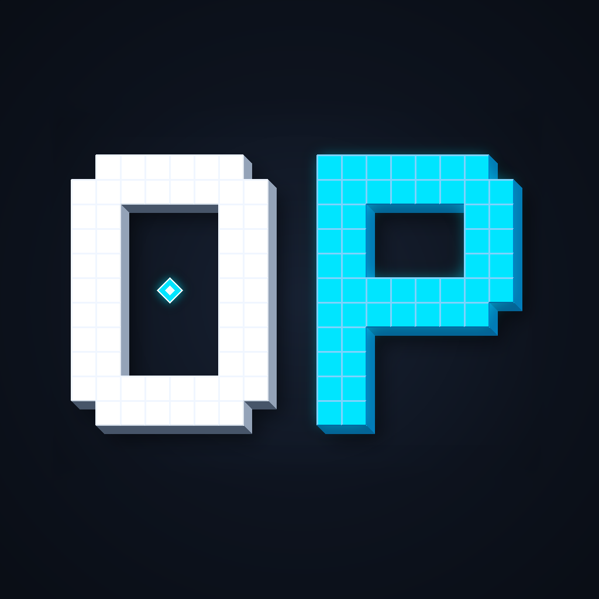

<p align="center">
  
</p>

# OpenStage

OpenStage is a standalone in-game animation studio and cinematic toolkit for Minecraft 1.21.1 (Fabric).

## Features

- **Character Rigging:** Smooth bending rigs for Steve and Alex skins with anchored pivots.
- **Multi-Track Timeline:** Keyframing for bones, cameras, audio, particles, and text overlays.
- **Audio Synchronization:** Audio waveform visualization, interactive trimming, and audio splitting.
- **Cinematic Camera:** Smooth spline interpolation, curve easing presets, and keyframed camera tracks.
- **In-Game UI:** Dark slate interface with collapsible panels and dual language support (Russian and English).

## Quick Start

1. Install **Fabric Loader** (0.19.5+) and **Fabric API** on Minecraft 1.21.1.
2. Drop the mod `.jar` into `.minecraft/mods`.
3. In-game:
   - Press **`O`** to open the animation studio.
   - Obtain the Model Block using `/give @s openstage:model_block` (or find it in the Creative tab under Functional Blocks).

## Building from source

Requirements:
- JDK 21+

Run Gradle to compile and build the mod jar:

```bash
./gradlew build
```

The compiled mod jar will be in `build/libs/openstage-1.21.1.jar`.

## License

MIT License